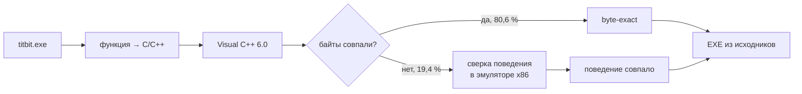

<h1 align="center">Ядерный Титбит</h1>

<p align="center"><b>Восстановленные исходники игры. Windows 10/11 и нативный Linux-порт.</b></p>
<p align="center">VZlab · Бука · 2003</p>


Код игры восстановлен по оригинальному `titbit.exe`. Сборка Windows работает на
Windows 10/11; Linux-порт собирается в нативный ELF32 и использует SDL2, OpenGL и FFmpeg.
Для современных Windows добавлены полный экран
(**Alt+Enter / F11**), воспроизведение видео без старых кодеков и запуск без диска.

> [!IMPORTANT]
> **Для игры нужна ваша копия «Ядерного Титбита»** — оригинальный CD, образ диска
> (ISO / IMG / CUE / CCD) или установленная игра. Уровни, модели, музыка, озвучка и видео
> берутся оттуда: в репозиторий и готовые сборки они **не входят**.

<details>
<summary>Где взять данные игры?</summary>

Права на игру, музыку и другие оригинальные материалы принадлежат их правообладателям, поэтому мы их не распространяем. ISO или установщик игры ищите на всем известных сайтах ;)

</details>

## Установка Windows

1. Скачайте `TitbitModern-*-windows-x64.zip` из [Releases](https://github.com/offx366/titbit-modern/releases)
   и распакуйте в любую папку, например `C:\Games\TitbitModern`.
2. Запустите **TitbitSetup.exe** и укажите, откуда взять данные игры:
   - **диск** — вставьте CD и выберите привод;
   - **образ** — выберите файл ISO, IMG, CUE или CCD (монтировать не нужно);
   - **установленная игра** — выберите её папку.

   Нажмите **«Добавить файлы игры»**. Программа сама найдёт и скопирует `QUEST.ezd`
   и 18 видеороликов и проверит их. Старый установщик запускать не нужно.
3. Запустите **TitbitModern.exe** — игра. **TitbitSettings.exe** — размер окна,
   полный экран, пропорции 4:3 или растяжение.

После импорта диск больше не нужен. Python, компилятор и интернет не требуются.
Если что-то не получилось: [docs/GETTING_STARTED.md](docs/GETTING_STARTED.md).

## Установка Linux

Нативная сборка (ELF32), без Wine. Python и компилятор не нужны. Варианты:

**Flatpak — любой дистрибутив.** Скачайте `Titbit-*-x86_64.flatpak` из
[Releases](https://github.com/offx366/titbit-modern/releases):

```bash
flatpak remote-add --user --if-not-exists flathub https://dl.flathub.org/repo/flathub.flatpakrepo
flatpak install --user flathub org.freedesktop.Platform.Compat.i386//25.08 org.freedesktop.Platform.GL32.default//25.08
flatpak install --user Titbit-*-x86_64.flatpak
flatpak run io.github.offx366.Titbit
```

Вторая строка — 32-битные библиотеки с Flathub (у кого стоит Steam из Flathub, они уже есть).
Игра появится и в меню приложений.

**Архив — Ubuntu 24.04+, Debian 13+, Fedora 39+ и другие системы с glibc 2.38+.**

1. Установите 32-битные OpenGL, X11 и звук (Ubuntu / Debian):

   ```bash
   sudo dpkg --add-architecture i386 && sudo apt update
   sudo apt install libgl1:i386 libgl1-mesa-dri:i386 libx11-6:i386 libxext6:i386 libxcursor1:i386 libxi6:i386 libxrandr2:i386 libpulse0:i386
   ```

   Если у вас стоит Steam, они, скорее всего, уже есть.

2. Скачайте `Titbit-*-linux-x86.tar.gz` из [Releases](https://github.com/offx366/titbit-modern/releases)
   и запустите:

   ```bash
   tar -xzf Titbit-*-linux-x86.tar.gz && cd Titbit-*-linux-x86
   sh start-game.sh
   ```

При первом запуске откроется мастер импорта: укажите ISO / IMG / CUE / CCD, папку
установщика (`data1.hdr`, `data*.cab`) или установленную игру — `QUEST.ezd` и 18 роликов
скопируются и проверятся. Дальше игра запускается сразу. Studio: `sh tools/start_studio.sh`
(во Flatpak — `flatpak run io.github.offx366.Titbit --studio`).

**Nix / NixOS:** `nix run github:offx366/titbit-modern` соберёт и запустит игру.
Подключение к конфигурации NixOS и подробности: [linux-port/docs/NIX.md](linux-port/docs/NIX.md).

**macOS и ARM Linux:** нативной версии нет. Экспериментально — через Nix с эмуляцией QEMU
([NIX.md](linux-port/docs/NIX.md)); Windows-версию можно попробовать в CrossOver / Wine.
Расскажите в Issues, что получилось.


Сборка из исходников: [linux-port/docs/BUILD-LINUX.md](linux-port/docs/BUILD-LINUX.md)
(`python3 tools/build_linux.py --minimal`). Проверки: [VALIDATION-LINUX.md](docs/VALIDATION-LINUX.md).

Экспериментальный перенос в браузер: [WebAssembly и Nix](linux-port/docs/WEB.md).
Проверены все 70 сцен, 417 сценариев и 18 видеороликов: модели, анимации, диалоги,
предметы и игровое меню исполняет исходный движок в WebAssembly. Сохранения из меню
записываются в IndexedDB и загружаются после перезапуска страницы. Нужны ваши
`QUEST.ezd` и AVI-файлы. Полное прохождение всех квестовых веток пока не проверено.

## Titbit Studio

Редактор сцен в комплекте. В Windows запустите **TitbitStudio.exe**, в Linux —
`sh tools/start_studio.sh`. В браузере откроются все 70 локаций игры:
свободная камера, выбор и перемещение объектов, анимации, экспорт в Blender (OBJ / GLB)
и обратно, сборка своего мода. Файлы игры при этом не меняются.


Управление: [editor/README.md](editor/README.md).

## Насколько это оригинал

Каждая из **4 955** функций игры переписана на C/C++, собрана тем же компилятором, что и
в 2003 году (Visual C++ 6.0), и сверена с оригинальным EXE.

Ниже — результаты исходного восстановления. Актуальные совместимые сборки используют
современные компиляторы; их машинный код отличается от проверочной VC6-сборки.

| | Байт кода | |
|---|---|---|
| Совпадает с оригиналом **байт в байт** | 633 954 | **80,6 %** |
| Поведение совпадает, байты отличаются | 152 527 | **19,4 %** |
| **Итого соответствует оригиналу** | **786 481** | **100 %** |

```
байт в байт   ████████████████████████████████████████░░░░░░░░░░   80,6 %
поведение     ██████████████████████████████████████████████████  100,0 %
```



🕵️ [Находки в коде](docs/TRIVIA.md) — секретный пароль, вырезанный контент и приколы разработчиков.

## Сборка из исходников

**VC6 больше не требуется.** Linux собирается Clang 18 с открытыми Win32-заголовками
mingw-w64. Windows использует LLVM-MinGW и современные MSVC Build Tools / Windows SDK.
Общий слой `portable/` сохраняет необходимые форматы объектов восстановленного движка.
Данные игры и инструменты Microsoft в репозиторий не входят.

<details>
<summary><b>Windows</b></summary>

Нужны Python 3.11, [LLVM-MinGW 20240619](https://github.com/mstorsjo/llvm-mingw/releases/tag/20240619)
(`ucrt-x86_64.zip`) и Visual Studio 2022 Build Tools с компонентом C++ x86/x64 и Windows SDK.
LLVM-MinGW распакуйте, например, в `C:\Tools`; IDE запускать не требуется.

```powershell
git clone https://github.com/offx366/titbit-modern.git
cd titbit-modern
$env:TITBIT_LLVM = 'C:\Tools\llvm-mingw-20240619-ucrt-x86_64'
py -3.11 -m venv .venv
.\.venv\Scripts\python.exe -m pip install -r requirements.txt
.\.venv\Scripts\python.exe tools/build_modern.py --check   # проверка инструментов
.\.venv\Scripts\python.exe tools/build_modern.py --fresh --test-runtime
```

Результат — `build/modern-portable/TitbitModern.exe` и `TitbitSettings.exe`.
Импорт данных: `python tools/titbit_setup.py --import "D:\Titbit.iso" --dest build/modern-portable`.
Portable-пакет как в Releases (с TitbitSetup и TitbitStudio):

```powershell
.\.venv\Scripts\python.exe -m pip install -r requirements-build.txt
.\.venv\Scripts\python.exe tools/package_portable.py --game-build build/modern-portable
```

Подробно: [docs/BUILD.md](docs/BUILD.md). Проверки сборок без VC6:
[docs/VALIDATION-NO-VC6.md](docs/VALIDATION-NO-VC6.md).

</details>

<details>
<summary><b>Linux</b></summary>

Ubuntu 24.04 x86-64 (или WSL2). Сборка: Clang/LLVM 18 → ELF32, без Wine.

```bash
sudo dpkg --add-architecture i386 && sudo apt update
sudo apt install git curl python3 clang-18 llvm-18 lld-18 gcc-multilib g++-multilib pkg-config mingw-w64-i686-dev libsdl2-dev:i386 libgl1-mesa-dev:i386 libglu1-mesa-dev:i386 zlib1g-dev:i386

git clone https://github.com/offx366/titbit-modern.git
cd titbit-modern/linux-port
python3 tools/build_linux.py --minimal --check   # проверка инструментов
python3 tools/build_linux.py --minimal --jobs "$(nproc)" --test-runtime
```

Результат — `build/titbit`. `--minimal` при первой сборке скачивает официальные архивы
FFmpeg и SDL2 (с проверкой SHA-256), собирает их урезанными в `~/.cache/titbit/` и вшивает
в игру: готовому файлу нужны только 32-битные glibc и OpenGL. Запуск:

```bash
python3 tools/titbit_setup.py --import /path/to/disc.iso --dest ~/.local/share/titbit/game
./build/titbit --data ~/.local/share/titbit/game
```

Пакеты как в Releases (нужны ещё `python3-venv python3-tk`, для Flatpak — `flatpak-builder`):

```bash
sh tools/build_tools.sh            # build/titbit-tools: импорт + Studio одним файлом
python3 tools/package_linux.py --version dev --commit "$(git rev-parse --short HEAD)" --out dist/Titbit-dev-linux-x86.tar.gz
sh flatpak/build_flatpak.sh dev    # dist/Titbit-dev-x86_64.flatpak
```

Подробно: [linux-port/docs/BUILD-LINUX.md](linux-port/docs/BUILD-LINUX.md).

</details>

---

Проверено: сборка из этого репозитория, импорт с образа диска, игра от меню до первой улицы.
Полное прохождение и разные видеокарты ещё не проверены — пишите о проблемах в Issues.

Игра и её материалы — © VZlab / Бука. Данные игры и инструменты Microsoft не распространяются.
[Сторонние библиотеки](THIRD_PARTY_NOTICES.md) · [Данные игры](docs/ASSETS.md)
